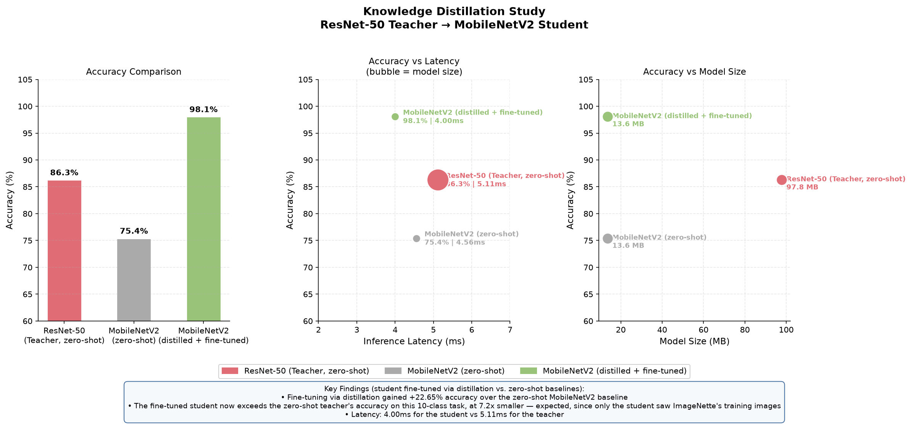

# Knowledge Distillation Study

Distills a frozen ResNet-50 teacher into a MobileNetV2 student on ImageNette, using Hinton-style soft-label KL divergence combined with an intermediate feature-matching loss. Benchmarks accuracy, latency, and model size across teacher, zero-shot student, and distilled student.

## Overview

```
download_data.py  →  teacher.py           →  distill.py              →  compare.py
  (ImageNette,         (frozen ResNet-50       (MobileNetV2 student,       (accuracy/latency/size
   10-class subset      teacher + zero-shot     logit + feature             chart + summary table)
   of ImageNet)          MobileNetV2 baseline,   distillation, 15 epochs)
                         both zero-shot →
                         results.json)
```

## Results



| Model | Accuracy | Latency | Size |
|---|---|---|---|
| ResNet-50 (teacher, zero-shot) | 86.29% | 5.11ms | 97.8 MB |
| MobileNetV2 (zero-shot, no distillation) | 75.41% | 4.56ms | 13.6 MB |
| MobileNetV2 (distilled + fine-tuned) | 98.06% | 4.00ms | 13.6 MB |


## How it works

- **Data**: [ImageNette](https://github.com/fastai/imagenette) (`download_data.py`), a 10-class subset of ImageNet. Since both models keep their original 1000-way ImageNet classifier head, `common.py`'s `IMAGENETTE_TO_IMAGENET` mapping translates ImageNette's 10 folder labels to their corresponding ImageNet-1k indices for both training targets and accuracy scoring.
- **Baselines** (`teacher.py`): evaluates a frozen, off-the-shelf ResNet-50 and an off-the-shelf MobileNetV2 zero-shot on the ImageNette validation set, and writes `results.json`.
- **Distillation** (`distill.py`): trains the student with a combined loss —
  - **Logit distillation** (`losses.py::distillation_loss`): `alpha * cross_entropy(student, hard_labels) + (1 - alpha) * KL(student_soft, teacher_soft) * T²`, the standard Hinton et al. formulation, `T=4.0`, `alpha=0.1` (90% weight on matching the teacher's softened distribution).
  - **Feature distillation**: a 1x1 conv adapter projects the student's final feature map (1280 channels) into the teacher's feature space (2048 channels), and an MSE loss pulls the (global-average-pooled) student features toward the teacher's. The feature-loss weight anneals from 0.05 down over training (`0.05 * 0.9^epoch`) — strong early guidance, relaxed as the student's own signal strengthens.
  - 15 epochs, SGD with Nesterov momentum, cosine LR schedule.
- **Comparison** (`compare.py`): reads `results.json`, renders a 3-panel chart (accuracy bars, accuracy-vs-latency, accuracy-vs-size) plus a summary table — see `distillation_comparison.png`.

## Project structure

```
.
├── download_data.py              # Downloads + extracts ImageNette
├── common.py                     # Shared ImageNet<->ImageNette label mapping, loaders, eval, latency
├── losses.py                     # distillation_loss + FeatureDistillationHook (unit tested)
├── teacher.py                    # Zero-shot teacher + zero-shot student baselines -> results.json
├── distill.py                    # Logit + feature distillation training loop -> results.json
├── compare.py                    # Chart + summary table from results.json
├── results.json                  # Committed sample output (from the run described above)
├── distillation_comparison.png   # Committed chart (from the run described above)
├── tests/
│   └── test_losses.py            # Unit tests for the distillation loss and hook
└── requirements.txt
```

## Setup

```bash
python -m venv .venv && source .venv/bin/activate
pip install -r requirements.txt
python download_data.py   # ~1.4GB, only needed to re-run teacher.py / distill.py
```

## Usage

```bash
python teacher.py    # baselines -> results.json (~5 min on Apple Silicon MPS)
python distill.py    # distillation training -> results.json (~30-40 min, 15 epochs)
python compare.py    # regenerates distillation_comparison.png from results.json
```

`results.json` and `distillation_comparison.png` are committed as sample output, so `compare.py` can be re-run immediately without retraining anything.

## Tests

```bash
pytest tests/
```

Covers `losses.py`'s `distillation_loss`: reduces to plain cross-entropy at `alpha=1`, ignores hard labels at `alpha=0`, is ~0 when student/teacher/labels all agree confidently, is differentiable, and that the feature-hook correctly captures a layer's forward output. No GPU or dataset needed.

## Tech stack

PyTorch, torchvision (ResNet-50, MobileNetV2), matplotlib, pytest. Runs on Apple Silicon (MPS), CUDA, or CPU.

## Notes

- Model checkpoints (`*.pth`, up to ~98 MB) and the ImageNette dataset are gitignored — regenerate via the scripts above.
- See the **Results** caveat above before reusing these numbers in a write-up; the honest framing is "fine-tuning via distillation," not "distillation alone beats a 7x larger model."
